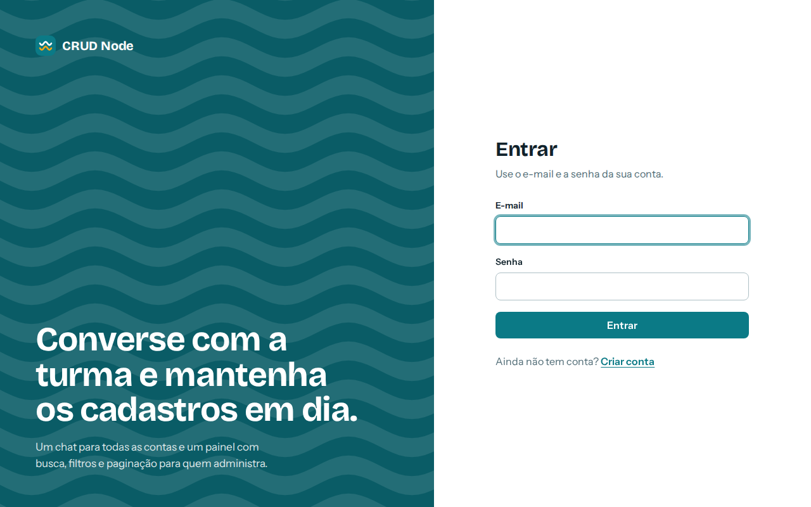
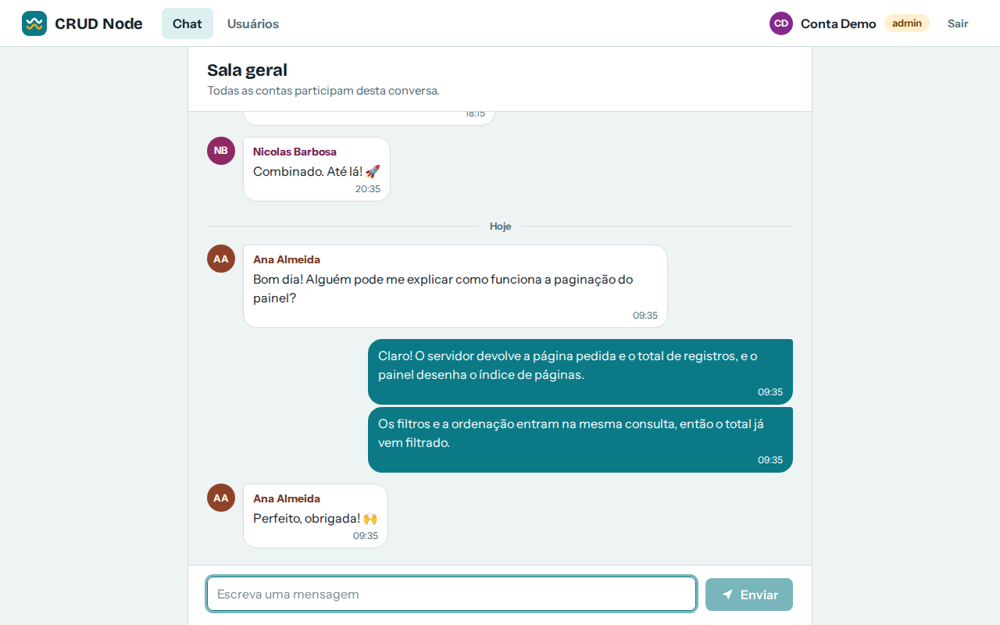
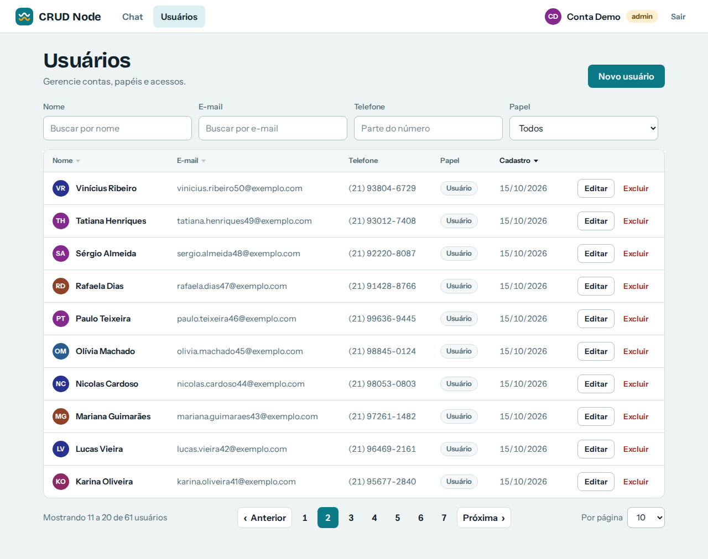
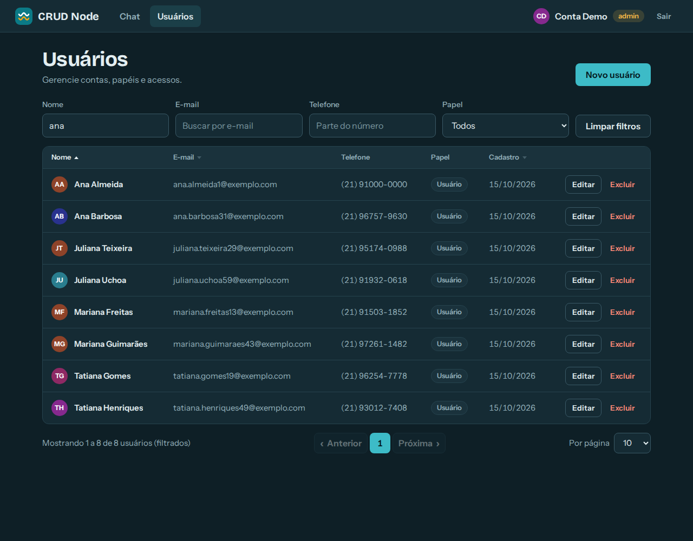
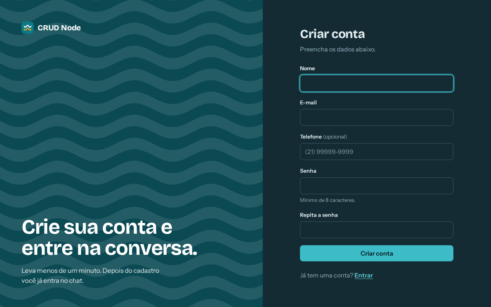
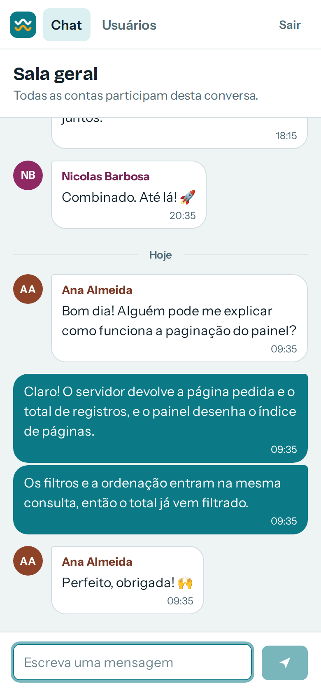
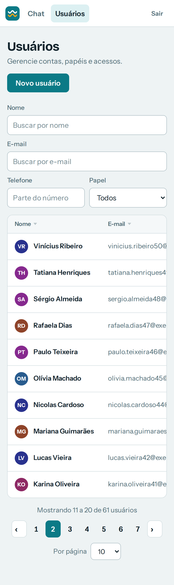

# ChatLegal

Aplicação em **Node.js, Express e MySQL/PostgreSQL** com:

- **Chat** em sala única, com as mensagens guardadas no banco de dados;
- **Painel de usuários** (CRUD) com **filtros, ordenação por coluna e índice de páginas**;
- **Criação de conta** pelo próprio site, com login e cadastro ligados um ao outro;
- **Script de geração das tabelas** (`npm run db:init`), que também atualiza bancos de versões anteriores.

## Como acessar o painel no deploy de demonstração

Acesse [Aqui](https://chat-legal.vercel.app/)   

Para acessar o chat: crie um usuário e faça login (sem reutilizar senhas reais!)
Para acessar o painel de administrador utilize as credenciais:
```bash
   email: demo@exemplo.com
   senha: senha12345
```

> Projeto originalmente feito para a disciplina *Construção de Aplicações Web* da FAETERJ-Rio, sendo posteriormente revitalizado e transformado em um chat público.

| Entrar | Chat |
|---|---|
|  |  |

| Painel de usuários (página 2) | Painel no tema escuro, filtrado e ordenado |
|---|---|
|  |  |

<details>
<summary>Cadastro (tema escuro) e telas no celular</summary>



 

</details>

## Como rodar

Requisitos: **Node.js 20+** e um servidor **MySQL** (ou PostgreSQL) acessível.

### Caminho rápido

```bash
npm install
npm run setup      # pergunta os dados do banco, gera o .env, cria as tabelas e o primeiro admin
npm start          # http://localhost:5000
```

### Passo a passo manual

```bash
npm install
cp .env.example .env       # preencha os dados do banco e o JWT_SECRET
npm run db:init            # cria o banco (se não existir) e as tabelas
npm run create-admin       # cria o primeiro administrador
npm start
```

Quer ver os filtros e a paginação com bastante dado? `npm run db:seed` cria 45 contas e algumas mensagens de exemplo

### Scripts

| Comando | O que faz |
|---|---|
| `npm start` | Sobe o servidor |
| `npm run dev` | Sobe o servidor reiniciando a cada alteração (nodemon) |
| `npm run setup` | Assistente interativo: gera o `.env`, cria as tabelas e o primeiro admin |
| `npm run db:init` | **Gera as tabelas.** Seguro rodar quantas vezes quiser |
| `npm run build:web` | Gera os scripts do navegador (`public/js/`) a partir de `web/` |
| `npm run db:seed [-- 120]` | Dados de demonstração (quantidade opcional) |
| `npm run create-admin` | Cria um admin, ou promove uma conta existente e redefine a senha |
| `npm run hash-password -- "senha"` | Imprime o hash bcrypt de uma senha |
| `npm test` | Testes automatizados (veja [Testes](#testes)) |

## Banco de dados

### Tabelas

```
usuarios                                    mensagens
  id          int, chave primária              id          bigint, chave primária
  nome        varchar(498)                     usuario_id  int  ──► usuarios.id  (ON DELETE SET NULL)
  email       varchar(255), ÚNICO              texto       varchar(500)
  telefone    char(11), opcional               criado_em   timestamp
  senha       hash bcrypt
  papel       'usuario' | 'admin'
  criado_em   timestamp
```

- **Uma só tabela de contas.** Quem pode entrar no painel é definido pelo `papel`, não por uma tabela à parte.
- **Mensagens sobrevivem à conta.** Se uma conta é excluída, as mensagens ficam e o autor aparece como "Usuário removido".
- **`utf8mb4`** em todas as tabelas (e na conexão) para que emojis funcionem no chat. O `utf8` antigo do MySQL tem só 3 bytes por caractere.
- **Datas em UTC** no banco; o navegador mostra no fuso de quem está olhando.

Os scripts SQL puros estão em [`database/mysql.sql`](database/mysql.sql) e [`database/postgres.sql`](database/postgres.sql),
caso você prefira rodá-los manualmente.

## Contas e permissões

| | Visitante | Usuário | Admin |
|---|:-:|:-:|:-:|
| Criar conta / entrar | ✅ | | |
| Usar o chat | | ✅ | ✅ |
| Painel de usuários (criar, editar, excluir) | | | ✅ |

- **Quem se cadastra pelo site sempre vira `usuario`.** O servidor ignora qualquer `papel` enviado no cadastro.
- Para criar administradores: `npm run create-admin`, ou, no painel, um admin altera o papel de outra conta.
- Um admin **não consegue excluir a si mesmo nem rebaixar o próprio papel**, para não se trancar para fora.
- A sessão é revalidada no banco a cada requisição: uma conta excluída ou rebaixada perde o acesso imediatamente,
  sem esperar o token expirar (a sessão dura 8 horas, configurável com `SESSION_HOURS`).

## Login e cadastro: como funcionam

Os formulários **sempre enviam por POST**, com os dados no corpo da requisição, e **nunca pela URL**. Isso vale mesmo quando o
JavaScript da página não carrega (navegador antigo, bloqueio, falha de rede): nesse caso o formulário é enviado como um POST clássico,
o servidor responde com um redirecionamento e, se algo der errado, a própria página mostra o motivo ("E-mail ou senha incorretos.",
"As senhas não são iguais.", "Confira os campos: e-mail, senha."). Ou seja, **login e cadastro funcionam com ou sem JavaScript**.

- Com JavaScript, a página envia `fetch` com JSON e mostra os erros ao lado de cada campo.
- Sem JavaScript, o navegador envia `application/x-www-form-urlencoded` para as mesmas rotas (`POST /auth/login` e `POST /auth/cadastro`).
- `GET /auth/login` e `GET /auth/cadastro` respondem **405** (`Allow: POST`).
- Se algum cliente mandar `senha`, `password`, `confirmarSenha` ou `token` **na URL**, o servidor não processa: devolve o navegador à
  mesma página sem a query string (limpando a barra de endereço e o histórico) ou responde 400 em requisições que não são GET.
- A mensagem de erro exibida vem de uma **lista fixa de códigos** (`?erro=credenciais`); nada digitado na URL é refletido na página.

## Painel de usuários

- **Filtros** por nome, e-mail, telefone e papel (combináveis, sem diferenciar maiúsculas; no MySQL também ignora acentos).
  O texto digitado vale literalmente: `%` e `_` não funcionam como curingas.
- **Ordenação** clicando no cabeçalho de Nome, E-mail ou Cadastro. Por padrão, os mais recentes aparecem primeiro.
- **Índice de páginas** com no máximo 7 posições (`1 … 9 10 11 … 20`), botões Anterior/Próxima, resumo
  ("Mostrando 11 a 20 de 143 usuários") e seletor de itens por página (10, 25, 50, 100).
- Filtros, ordem, página e itens por página ficam **na URL**: dá para atualizar a página, usar o botão "voltar" e
  compartilhar o link de uma busca.
- A senha é **opcional ao editar** (em branco = manter a atual) e o telefone é opcional.

## Chat

Sala única, aberta a todas as contas, com histórico persistido no banco: as últimas 50 mensagens aparecem ao entrar.
Enter envia, Shift+Enter quebra a linha, o limite é 500 caracteres (emojis contam como 1) e há agrupamento por autor,
divisores de dia e um aviso "Novas mensagens" quando você está lendo o histórico.

**Como as mensagens chegam: polling.** A página pergunta ao servidor "há mensagens depois da nº X?" a cada 3 segundos
(`GET /mensagens?depois=X`, que usa a chave primária e é barato). Escolhi isso em vez de WebSocket porque funciona igual em
servidor tradicional e em **serverless (Vercel)**, onde não existem conexões longas. A consulta pausa com a aba em segundo plano.
Se você hospedar em um servidor próprio e quiser entrega instantânea, o próximo passo natural é trocar o polling por
WebSocket ou Server-Sent Events, e o restante (rotas, banco, tela) continua igual.

Ainda não existem: moderação de mensagens, salas privadas, mensagens diretas e rolagem para carregar o histórico antigo.

## API

Todas as rotas respondem JSON. Erros de validação vêm como `{ message, errors: [{ campo, mensagem }] }`.

| Método e rota | Acesso | Descrição |
|---|---|---|
| `POST /auth/cadastro` | público | Cria a conta (papel `usuario`) e já inicia a sessão |
| `POST /auth/login` | público | Inicia a sessão (cookie `httpOnly`). Só POST; aceita JSON ou formulário clássico |
| `POST /auth/logout` | | Encerra a sessão |
| `GET /auth/eu` | logado | Dados da conta logada |
| `GET /saude` | público | Diagnóstico: o banco responde e tem a estrutura esperada? (sem dados sensíveis) |
| `GET /mensagens[?depois=<id>]` | logado | Últimas 50 mensagens, ou só as mais novas que `<id>` |
| `POST /mensagens` | logado | Envia `{ texto }` (1 a 500 caracteres) |
| `GET /usuarios` | admin | Lista paginada: `pagina`, `limite` (1 a 100), `nome`, `email`, `telefone`, `papel`, `ordenar` (`id`, `nome`, `email`, `criado`), `direcao` (`asc`/`desc`) |
| `POST /usuarios` | admin | Cria conta (aceita `papel`) |
| `PATCH /usuarios/:id` | admin | Atualiza só os campos enviados |
| `DELETE /usuarios/:id` | admin | Exclui a conta |

`GET /usuarios` responde `{ dados: [...], paginacao: { pagina, limite, total, totalPaginas, paginas: [1, '…', 9, 10, 11, '…', 20] } }`.
Se a página pedida não existir mais (por exemplo, depois de excluir o último item da última página), o servidor devolve a mais próxima válida.

## Segurança

- Senhas com **bcrypt**; a senha (nem o hash) nunca sai da API. Senhas acima de 72 bytes são recusadas, pois o bcrypt ignoraria o excedente.
- **Credenciais nunca na URL**: formulários com `method="post"`, `GET` de login recusado (405) e query strings com senha descartadas.
- Sessão por **JWT em cookie `httpOnly` + `sameSite=strict`** (`secure` em produção).
- Login com resposta idêntica para "e-mail não existe" e "senha errada", e com tempo de resposta equivalente.
- **Consultas parametrizadas** em todo o acesso ao banco; as colunas de ordenação vêm de uma lista fechada.
- **Sem XSS**: a interface monta tudo com `textContent` (nunca `innerHTML`). Isso importa porque, com cadastro aberto,
  qualquer pessoa poderia criar um nome com HTML e atacar o admin que visse a lista.
- **CSP restrita**: `script-src 'self'` e `style-src 'self'`, sem scripts nem estilos inline e sem CDN (as fontes são
  servidas pelo próprio projeto).
- **Limite de tentativas**: 10 logins errados por 15 min e 10 cadastros por hora (por IP); 30 mensagens por minuto (por conta).
  A contagem fica na memória do processo, então em serverless (várias instâncias) é um freio parcial.
- O cadastro revela se um e-mail já está em uso (necessário para dar uma mensagem útil). O login não revela.


## Estrutura

```
├── api/index.js              # entrada serverless (Vercel), reaproveita src/app.js
├── database/
│   ├── mysql.sql  postgres.sql   # esquemas (IF NOT EXISTS)
│   ├── schema.js                 # ensureSchema: cria e atualiza o esquema (usado por db:init e setup)
│   ├── admin.js  connection.js  config.js
├── web/                      # CÓDIGO-FONTE do front-end (módulos ES): api, ui, shell, diagnostico e um arquivo por página
├── public/
│   ├── css/app.css               # único CSS, tema claro/escuro
│   ├── js/                       # GERADO por `npm run build:web`: um script clássico por página (não edite)
│   ├── fonts/ img/               # Bricolage Grotesque e Instrument Sans (licença OFL), marca e ondas
│   └── login.html cadastro.html chat.html dashboard.html
├── scripts/                  # setup, createTables, createAdmin, seed, hashPassword
├── src/
│   ├── config/               # variáveis de ambiente e pool de conexões (MySQL/PostgreSQL)
│   ├── controllers/          # o que cada rota faz
│   ├── repositories/         # SQL (usuários e mensagens)
│   ├── middleware/           # autenticação por papel, validação, limites, erros
│   ├── routes/  validators/  utils/   # inclui healthRoutes (/saude) e utils/formulario.js (login sem JavaScript)
│   └── app.js  server.js
└── tests/                    # testes de integração (node:test)
```

## Licença

ISC. As fontes em `public/fonts` são distribuídas sob a SIL Open Font License (os textos estão na mesma pasta).
